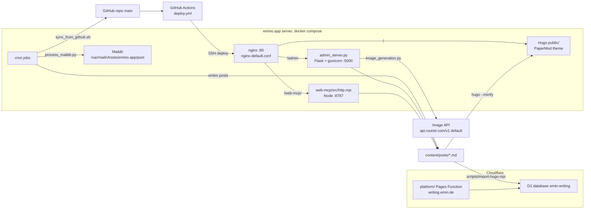
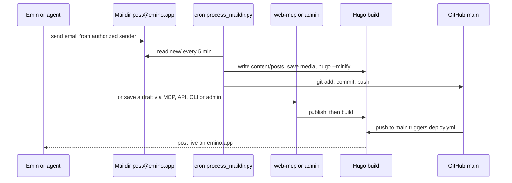

# Emino.app Blog

Static Hugo blog that powers [https://emino.app](https://emino.app), plus a Flask admin, a Maildir email-to-post pipeline and cron health checks.
It also ships `web-mcp/` (MCP, HTTP API and CLI publishing harness) and `platform/` (Cloudflare Pages + D1 writing site for `writing.emin.de`).
For Emin, publishing as a person, by email, or through agents.

## Logs

- [CHANGELOG.md](CHANGELOG.md) - release notes, newest first
- [PROMPTLOG.md](PROMPTLOG.md) - rules and prompts that shaped this repo

## Status

| Field | Value |
|---|---|
| Version | v0.1.0 |
| Date | 2026-10-14 |
| Updated by | hermes-agent for emino |
| Default-branch HEAD | `86379ef6` (main) |
| Blog | `https://emino.app` (`config.toml` baseURL). Deployed by `.github/workflows/deploy.yml` on push to `main`: Hugo build, `web-mcp` selfcheck, SSH to server, `git pull` + `docker compose up -d --build` in `/var/www/emino-blog` |
| Writing platform | `https://writing.emin.de` (`ORIGIN` in `platform/functions/[[path]].js`). Cloudflare Pages project `emin-writing`, deployed manually with `npm run deploy` in `platform/` |

## Architecture



## User flow



## Components

| Component | Path | Role |
|---|---|---|
| Hugo site config | `config.toml` | baseURL `https://emino.app/`, theme PaperMod |
| Posts | `content/posts/` | Markdown sources, 88 files |
| Layouts and assets | `layouts/`, `assets/`, `archetypes/` | Hugo templates and styles |
| Static files | `static/` | Copied verbatim. `static/media/<slug>` holds post images. Also `llms.txt`, `robots.txt` |
| Admin | `admin_server.py` | Flask admin at `/admin`: email check, GitHub sync, rebuild, post edit and approve, image generation |
| Image generation | `image_generation.py` | Cover images via OpenAI-style image API, Routstr base URL by default |
| Email ingestion | `scripts/process_maildir.py` | Maildir to Hugo post, rebuild, git push |
| Other scripts | `scripts/` | Older email processors, GitHub sync, SEO audit, search-engine submit, favicon and image helpers |
| Web MCP harness | `web-mcp/` | MCP (stdio + HTTP), HTTP API, CLI and browser playground over the same content files. See [web-mcp/README.md](web-mcp/README.md) |
| Web MCP config | `web-mcp.config.json` | Site name, baseUrl, content kinds |
| Writing platform | `platform/` | Cloudflare Pages Function, React admin, D1 (`schema.sql`), MCP and agent discovery for `writing.emin.de` |
| Container build | `Dockerfile`, `docker-compose.yml` | Stages: hugo, admin, web-mcp, final nginx |
| nginx | `nginx-default.conf` | Routes `/`, `/admin`, `/web-mcp/` |
| Ops scripts | `build.sh`, `deploy.sh`, `health-check.sh`, `seo-optimizer.sh`, `setup-cron.sh` | Manual build, rsync deploy, health and SEO cron jobs |
| CI | `.github/workflows/deploy.yml` | Build, selfcheck, SSH deploy on push to `main` |

## API / Endpoints

### Flask admin (`admin_server.py`)

| Method | Path | Auth | Purpose |
|---|---|---|---|
| GET | `/admin` | none | Admin UI, login form |
| POST | `/admin/login` | none | Check credentials, start session |
| GET | `/admin/logout` | none | End session |
| POST | `/admin/check-emails` | session | Run the mail ingestion script |
| POST | `/admin/sync-github` | session | Run the GitHub sync script |
| POST | `/admin/rebuild` | session | Rebuild Hugo |
| GET | `/admin/posts` | session | List posts |
| GET | `/admin/post` | session | Read one post |
| POST | `/admin/save-post` | session | Save post |
| POST | `/admin/approve-post` | session | Un-draft a post, rebuild, git publish |
| POST | `/admin/create-image` | session | Generate a cover image |
| POST | `/admin/delete-post` | session | Delete a post |
| GET | `/admin/logs` | session | Tail email and sync logs |
| GET | `/admin/stats` | session | Stats |

### Web MCP HTTP (`web-mcp/src/http.mjs`, port 8787)

Writes need `Authorization: Bearer <WEB_MCP_TOKEN>`.

| Method | Path | Auth | Purpose |
|---|---|---|---|
| POST | `/web-mcp/mcp` | bearer for write tools | MCP Streamable HTTP |
| GET | `/web-mcp/api/site` | none | Read site config |
| PATCH | `/web-mcp/api/site` | bearer | Update site config |
| GET | `/web-mcp/api/articles` | none | List articles, `includeDrafts=true` optional |
| GET | `/web-mcp/api/article` | none | Read one article |
| POST | `/web-mcp/api/articles` | bearer | Save article as draft |
| POST | `/web-mcp/api/publish` | bearer | Publish article |
| POST | `/web-mcp/api/build` | bearer | Build the site |
| GET | `/web-mcp/` | none | Browser playground, `web-mcp/public/` |

### Web MCP tools (`web-mcp/src/server.mjs`)

| Tool | Purpose |
|---|---|
| `site_get` | Read site config |
| `site_update` | Update site config |
| `article_list` | List articles |
| `article_get` | Read one article |
| `article_save` | Save draft |
| `article_publish` | Publish article |
| `site_build` | Build site |

### Web MCP CLI (`web-mcp/src/cli.mjs`, bin `web-mcp`)

`site:get`, `site:update`, `article:list`, `article:get`, `article:save`, `article:publish`, `build`. Args as `--key value`.

### Writing platform (`platform/functions/[[path]].js`, `writing.emin.de`)

Admin auth = bearer `ADMIN_TOKEN` or signed `emin_session` cookie.

| Method | Path | Auth | Purpose |
|---|---|---|---|
| GET | `/`, `/about`, `/<kind>`, `/<kind>/<slug>` | none | HTML pages. Kinds: write, film, photo, code, music |
| GET | `/api/articles` | none | Published articles |
| GET | `/api/articles/<id-or-slug>` | none | One article as JSON |
| GET | `/api/articles/<id-or-slug>.md` | none | One article as Markdown |
| GET | `/api/admin/me` | none | Session check |
| POST | `/api/admin/login` | none | Login, sets `emin_session` cookie |
| POST | `/api/admin/logout` | none | Clear cookie |
| GET | `/api/admin/articles` | admin | List all non-deleted articles |
| POST | `/api/admin/articles` | admin | Create article |
| PUT | `/api/admin/articles/<id>` | admin | Update article |
| DELETE | `/api/admin/articles/<id>` | admin | Soft delete |
| GET, POST | `/mcp` | admin for write tools | MCP over HTTP JSON-RPC |
| GET | `/admin`, `/admin/` | UI login | React admin |
| GET | `/rss.xml`, `/feed.json`, `/sitemap.xml`, `/robots.txt`, `/llms.txt`, `/llms-full.txt`, `/openapi.json`, `/skill.md`, `/auth.md`, `/favicon.ico` | none | Feeds and agent discovery |
| GET | `/.well-known/api-catalog`, `/.well-known/mcp/server-card.json`, `/.well-known/agent-card.json`, `/.well-known/agent-skills/index.json`, `/.well-known/webmcp.json`, `/.well-known/oauth-authorization-server`, `/.well-known/oauth-protected-resource`, `/.well-known/commerce.json` | none | Well-known discovery docs |

MCP tools: `search_work`, `list_work`, `get_work` (public). `create_draft`, `update_work`, `publish_work`, `delete_work` (admin).

## Run

Blog, admin and web-mcp via Docker:

```bash
docker compose up -d --build     # nginx :80, admin :5000, web-mcp :8787
```

Hugo only:

```bash
git clone --depth 1 https://github.com/adityatelange/hugo-PaperMod.git themes/PaperMod
hugo server                      # preview
hugo --minify --gc               # build, same as CI
```

Admin without Docker:

```bash
pip install -r requirements.txt  # Flask, gunicorn
gunicorn --bind 0.0.0.0:5000 admin_server:app
```

Web MCP:

```bash
cd web-mcp
npm ci
npm start                        # HTTP on 8787
npm run mcp                      # MCP over stdio
npm run selfcheck                # CI check
```

Writing platform:

```bash
cd platform
npm ci
npm run dev                      # vite
npm run build
npm run check                    # selfcheck
npm run import:sql               # content/posts to import.sql
npm run deploy                   # wrangler pages deploy, manual
```

### Env var names

| Area | Names |
|---|---|
| Admin and scripts | `EMINO_BLOG_DIR`, `EMINO_MAILDIR`, `EMINO_MAIL_SCRIPT`, `EMINO_SYNC_SCRIPT`, `EMINO_HUGO_BIN`, `EMINO_EMAIL_LOG`, `EMINO_SYNC_LOG`, `EMINO_ADMIN_USERNAME`, `EMINO_ADMIN_USERNAME_FILE`, `EMINO_ADMIN_PASSWORD`, `EMINO_ADMIN_PASSWORD_HASH`, `EMINO_ADMIN_PASSWORD_HASH_FILE`, `EMINO_ADMIN_PUBLISH_LOG`, `EMINO_POSTS_DIR`, `EMINO_POSTS_TRASH`, `EMINO_STATIC_MEDIA_DIR`, `EMINO_BASE_URL`, `EMINO_GIT_BRANCH`, `EMINO_SKIP_GIT` |
| Email ingestion | `EMINO_AUTH_FILE`, `EMINO_POST_TOKEN`, `EMINO_POST_TOKEN_FILE`, `EMINO_POST_TOKEN_MARKER`, `EMINO_REQUIRE_POST_TOKEN`, `EMINO_POST_TITLE_MARKER`, `EMINO_REQUIRE_TITLE_MARKER`, `EMINO_REQUIRE_TO_ADDRESS`, `EMINO_REQUIRE_DMARC_PASS`, `EMINO_BLOCKED_RECEIVED_HOSTS`, `EMINO_NOTIFY_EMAIL`, `EMINO_NOTIFY_FROM`, `EMINO_SENDMAIL`, `EMINO_AUTO_GENERATE_IMAGE` |
| Image generation | `EMINO_IMAGE_API_KEY`, `ROUTSTR_API_KEY`, `OPENROUTER_API_KEY`, `EMINO_IMAGE_API_KEY_FILE`, `EMINO_IMAGE_API_BASE_URL`, `ROUTSTR_API_BASE_URL`, `EMINO_IMAGE_MODEL`, `EMINO_IMAGE_QUALITY`, `EMINO_IMAGE_OUTPUT_FORMAT`, `EMINO_IMAGE_MAX_WIDTH`, `EMINO_IMAGE_MAX_HEIGHT`, `EMINO_IMAGE_PROMPT_MAX_CHARS`, `EMINO_IMAGE_TIMEOUT`, `EMINO_OPENAI_IMAGE_TIMEOUT`, `EMINO_IMAGE_APP_TITLE`, `EMINO_IMAGE_HTTP_REFERER`, `EMINO_IMAGE_USER_AGENT` |
| Web MCP | `WEB_MCP_ROOT`, `WEB_MCP_TOKEN`, `WEB_MCP_CONFIG`, `WEB_MCP_CONTENT_DIR`, `WEB_MCP_BUILD_COMMAND`, `HOST`, `PORT` |
| Writing platform, Cloudflare bindings | `DB`, `ADMIN_TOKEN`, `ADMIN_USERNAME`, `ADMIN_PASSWORD_HASH`, `ADMIN_SESSION_SECRET` |
| CI secrets in deploy.yml | `HOST`, `USERNAME`, `SSH_KEY` |

## Repository layout

- `web-mcp/` - Open-source MCP, HTTP API, CLI, and browser publishing harness. See [`web-mcp/README.md`](web-mcp/README.md).
- `platform/` - Cloudflare Pages + D1 writing platform for `writing.emin.de`.
- `content/` - Markdown sources for Hugo posts.
- `static/` - Static assets copied verbatim during builds (`static/media/<slug>` holds post images and email attachments).
- `scripts/` - Operational helpers (email ingestion, GitHub sync, SEO / health automation).
- `admin_server.py` - Flask admin for manual operations (email ingestion, rebuilds, post edits, log tailing).
- `public/` - Hugo build output served by nginx (not tracked in this clone).

## How email posting works

1. `post@emino.app` receives mail via Postfix, which stores it inside `/var/mail/vhosts/emino.app/post`.
2. A cron job runs `scripts/process_maildir.py` every 5 minutes. The script now:
   - reads authorized senders from `scripts/email_auth.txt`,
   - parses each Maildir message (preferring plain text but falling back to HTML),
   - saves inline image attachments to `static/media/<slug>/`,
   - writes a Hugo post inside `content/posts/<timestamp>-<slug>.md`,
   - rebuilds the site once per batch with `hugo --minify`,
   - runs `git add/commit/push` so the new posts (and generated `public/` files) are safely stored on GitHub.
3. Processed emails are moved from `new/` to `cur/` so they are not reprocessed.

Because posts are now committed immediately, the GitHub sync script no longer wipes out newly created posts.

### Adding or removing authorized senders

Edit `scripts/email_auth.txt` (one address per line, comments are allowed) and the cron job / admin panel will pick up the new list automatically.

## Cron jobs on the server

```
*/5 * * * * /usr/bin/python3 /var/www/emino-blog/scripts/process_maildir.py   >> /var/log/email_processing.log 2>&1
*/5 * * * * /var/www/emino-blog/scripts/sync_from_github.sh                   >> /var/log/github-sync.log 2>&1
0  3 * * *  /var/www/emino-blog/seo-optimizer.sh                              >  /var/log/blog-seo.log 2>&1
0  */6 * * * /var/www/emino-blog/health-check.sh                              >  /var/log/blog-health.log 2>&1
```

## Admin dashboard

`admin_server.py` exposes `/admin` (proxied behind nginx). It now respects:

```
EMINO_BLOG_DIR   # defaults to the directory containing admin_server.py
EMINO_MAILDIR    # defaults to /var/mail/vhosts/emino.app/post
EMINO_MAIL_SCRIPT, EMINO_SYNC_SCRIPT, EMINO_HUGO_BIN
EMINO_EMAIL_LOG, EMINO_SYNC_LOG
```

These knobs make it easy to run the panel from Docker or on a workstation. Each action (`Check Emails`, `Sync GitHub`, `Rebuild Hugo`) executes the corresponding script inside the configured blog directory and streams stdout/stderr back to the UI.

## Docker / local development

`docker-compose.yml` defines three services:

- `nginx` (Dockerfile target `final`) serves `./public` and proxies `/admin` and `/web-mcp/`.
- `admin` (target `admin`) runs the Flask app with gunicorn on 5000.
- `web-mcp` (target `web-mcp`) mounts the repo at `/site`, runs `hugo --minify --gc`, then serves on 8787.

For a live preview without Docker, run `hugo server` (http://localhost:1313).

Override any `EMINO_*` environment variable in `docker-compose.yml`. When testing locally, set `EMINO_SKIP_GIT=1` so the ingestor skips `git add/commit/push`.

## Git / deployments

- `scripts/sync_from_github.sh` now performs a safe fast-forward sync (`git fetch`, `git pull --ff-only`) and refuses to run if there are uncommitted changes. This keeps server edits intact while still pulling upstream updates.
- `build.sh` / `deploy.sh` are available for manual Hugo builds and rsync deployments if you need to publish outside of cron/admin.
- Logs from cron lives in `/var/log/email_processing.log`, `/var/log/github-sync.log`, `/var/log/blog-health.log`, and `/var/log/blog-seo.log`. You can tail them via the admin UI or directly over SSH.

## Operational tips

- Always run `scripts/process_maildir.py` manually after changing its configuration to ensure it can read the Maildir and has git access.
- When updating Hugo/config/theme files, commit to GitHub and either run the admin "Sync GitHub" action or wait for the cron job.
- Keep the root `.gitconfig` authenticated via `gh auth login` so automated commits from the ingestor can push successfully.
